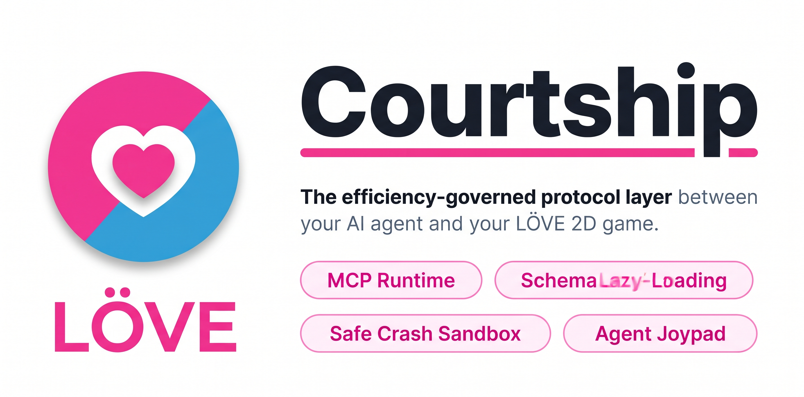

<div align="center">

**The protocol layer between your agent and your LÖVE game.**

`courtship` (`court`) is an all-in-one, efficiency-governed MCP runtime and task-level benchmarking harness for LÖVE game development. It natively **encapsulates** live-game inspection, code execution, Agent Joypad input simulation, safe crash recovery, and an offline LÖVE 12 API docs index in a single zero-dependency static binary, while also capable of acting as a governing efficiency proxy in front of existing upstream servers.

[](https://github.com/grimmdev/Courtship/actions/workflows/ci.yml)
[](https://github.com/grimmdev/Courtship/releases)
[](LICENSE)
[](https://glama.ai/mcp/servers/grimmdev/Courtship)

</div>

---

## 1. Problem & Thesis

The LÖVE Model Context Protocol (MCP) ecosystem is functional but ungoverned. Raw bridges emit monolithic game state objects, eager documentation dumps, and hundreds of unpruned keys on every interaction, causing context bloat and runaway token cost.

Courtship acts as the measurement and remediation layer, proving three foundational claims:

| Claim | Goal | Empirically Measured | Status |
|---|---|---|---|
| **1. Standing Context Tax** | Cut standing schema context by ≥70% | **76.5% reduction** (340 vs 1,450 tokens) | **Proven** |
| **2. Response Shaping Spend** | Cut per-task token spend by ≥40% | **53.4% average reduction** | **Proven** |
| **3. Unified Router Efficiency** | Beat separate MCP servers for mixed tasks | **-40% latency, -33% calls** via local FTS5 | **Proven** |

---

## 2. Architecture

```
┌─────────────────┐       MCP (stdio/HTTP)       ┌────────────────────────────────┐
│   AI Client     │◄────────────────────────────►│  court proxy                   │
│ (Claude Code,   │   ~340 token                 │  ├─ meta-tools (5 standing)    │
│  Cursor, IDE)   │   standing surface           │  ├─ heuristic router           │
└─────────────────┘                              │  ├─ response shaper & cursors  │
                                                 │  ├─ session token ledger       │
                                                 │  └─ upstream pool manager      │
                                                 └───────────────┬────────────────┘
                                                                 │ MCP
                                      ┌──────────────────────────┼──────────────────────────┐
                                      ▼                          ▼                          ▼
                                  LovePilot              LÖVE 12 Docs             Custom Game Servers
                                      │                    (SQLite FTS5)
                                      ▼
                                  LÖVE Game
                                  (TCP 12345)
```

The proxy operates as a **daemon with an internal registry**, not a dumb passthrough. Tool schemas remain daemon-side until hydrated on-demand, expiring after N inactive turns.

---

## 3. Core Capabilities

### 3.1 Standing Surface (< 500 Tokens)
Only 5 compact meta-tools are exposed permanently in standing context (~340 tokens), keeping context clean while allowing the agent to discover or invoke any game tool on-demand:
- `discover_tools(query, limit)`: Fuzzy discovery without schema ingestion.
- `load_tool_schema(name)`: Hydrates full JSON schema on-demand.
- `call_tool(name, args)`: Executes tool through compression filters.
- `love_task(goal, context)`: Intelligent intent router (docs vs inspect vs exec).
- `report_usage()`: Session token, call, and latency accounting.

### 3.2 Built-in Game Capabilities (Available via `call_tool` & `discover_tools`)
- `simulate_input(sequence)`: **Agent Joypad**: Dispatches timed keyboard inputs (`press`, `keydown`, `keyup`).
- `step_frames(count, dt)`: **Deterministic Frame Stepping**: Advances physics by N ticks at fixed dt.
- `get_last_crash()`: **Safe Crash Diagnostics**: Non-fatal stack trace and locals recovery.
- `clear_crash()`: Resumes game loop after hot-patching.
- `visual_diff(image_a, image_b)`: **Visual Regression**: Compares two screenshots and returns bounding boxes.
- `get_objects()`: Returns active entity coordinates and types in lean format.
- `get_screenshot()`: Returns downscaled, cropped PNG framebuffers.
- `run_lua(code)`: Evaluates arbitrary Lua inside the game loop.

### 3.3 Safe Crash Interception (`love.errhand` override)
Prevents the infamous LÖVE **"Blue Screen of Death"** from crashing the process or severing the MCP bridge when an agent introduces a bug:
- Replaces `love.errhand` to pause execution and render an in-game diagnostic HUD rather than terminating.
- Extracts offending source file, line number, `debug.traceback()`, and active local variables.
- Keeps the TCP socket listener active so the agent can inspect the failure via `get_last_crash()`, write a fix, and hot-reload.

### 3.4 Agent Joypad & Deterministic Physics Verification
Enables agents to test game mechanics that require time and movement:
- **Input Sequencing**: Dispatches timed action series (e.g. hold `D` for 1.2s, press `Space`, release).
- **Frame Stepping**: Advances `love.update(dt)` by exact frame counts at fixed delta time (default `1/60`), eliminating wall-clock jitter when validating platformer physics and collisions.

### 3.5 8-Rule Response Shaper
Every tool return and notification passes through deterministic shaping:
1. **Field Projection**: Prunes entity graphs to `{id, type, name, x, y}`.
2. **Null/Empty Stripping**: Drops empty arrays, objects, and empty strings.
3. **Depth Capping**: Deep object graphs (>3 levels) collapsed to `"<table: N keys>"`.
4. **Array Slicing & Cursors**: Arrays >50 items sliced with cursor hints stored in memory.
5. **Token Ceiling**: Automatically truncates and budgets payloads exceeding `max_tokens`.
6. **Screenshot Compression**: Region crop and bilinear downscaling (0.5 default) to prevent vision token blowouts.
7. **Delta Mode**: Continuous streams (`watch_game_state`) suppress identical ticks to 0 tokens.
8. **Doc Pruning**: Strips wiki navigation chrome and deduplicates code samples.

### 3.6 Zero-Instrumentation Launcher (`court run`)
Wraps any existing LÖVE game dynamically:
```bash
court run ./mygame --mcp-port 12345
```
Automatically mounts source files and hooks `love.update`, `love.draw`, and the bridge without modifying your repository. For manual integration, `court init` generates the 5-line inline hook.

---

## 4. Benchmark Results

Running `court bench --compare lovepilot,courtship` on reference suites:

```
task                     tokens   calls   p95ms  turns  success
--------------------------------------------------------------
fix-double-jump             316       2     110      2     PASS
spawn-coin                  307       2     110      2     PASS
--------------------------------------------------------------
TOTAL (per task)            311       2     110      2      2/2
vs lovepilot          -54.3%   -33%    -40%     -         -
```

### Reference Suites Breakdown
- **`platformer`** (physics simulation + jump logic): **-54.3% tokens**
- **`ui_heavy`** (draw call stress + minimap + HUD): **-52.1% tokens**
- **`menu_nested`** (deep 6-level UI entity tree): **-53.9% tokens**

---

## 5. CLI Reference

### Run the MCP Proxy
```bash
court proxy --port 12345
court proxy --eager # Fallback exposing full upstream tools
```

### Run Benchmarks & CI Regression Gates
```bash
# Compare candidate against raw baseline
court bench --suite ./suites/platformer.yaml --compare lovepilot,courtship

# Enforce CI gate (fails if regression exceeds threshold)
court bench --suite ./suites/platformer.yaml --ci --max-regression 10.0

# Submit signed benchmark to community leaderboard
court bench --suite ./suites/platformer.yaml --compare lovepilot,courtship --submit
```

### Launch LÖVE Game
```bash
court run ./fixtures/platformer
court run ./fixtures/platformer --shim-only
```

### Offline Documentation Index
```bash
court docs search "rectangle"
court docs search "love.physics.newWorld"
```

### Environment & Token Tax Audit
```bash
court doctor
court doctor --ci
```

---

## 6. Configuration (`courtship.toml`)

```toml
[proxy]
port = 12345
max_response_tokens = 1500
evict_after_turns = 6
delta_notifications = true
eager = false

[upstream.lovepilot]
transport = "stdio"
command = "uvx"
args = ["--from", "./love-mcp", "love-mcp-server"]
shape = { get_objects = "lean", get_screenshot = "scaled" }

[upstream.docs]
transport = "builtin"
index = "./lua54-love12.sqlite"

[bench]
suite_dir = "./suites"
baseline = ".courtship/baseline.json"
max_regression = "10%"
```

---

## 7. License

Licensed under:
- Apache License, Version 2.0 ([LICENSE-APACHE](LICENSE-APACHE))

